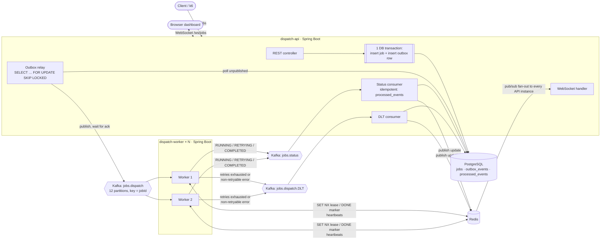

# Event-driven dispatch system



A set of Spring Boot services that send jobs to workers in real time. **Kafka** carries the messages,
**Redis** holds live state, **PostgreSQL** is the source of truth, and **WebSockets** push every status
change to the browser.

The project shows three patterns that make a distributed system correct when parts of it fail:

| Pattern | Problem it solves | Where |
|---|---|---|
| **Transactional outbox** | A database write and its Kafka message must both happen, or neither. | [`JobService`](dispatch-api/src/main/java/io/github/yassaminheidari/dispatch/api/job/JobService.java), [`OutboxRelay`](dispatch-api/src/main/java/io/github/yassaminheidari/dispatch/api/outbox/OutboxRelay.java) |
| **Idempotent consumers** | Kafka delivers at least once. A repeated message must have an effect only one time. | [`IdempotencyGuard`](dispatch-worker/src/main/java/io/github/yassaminheidari/dispatch/worker/IdempotencyGuard.java) (Redis), [`StatusService`](dispatch-api/src/main/java/io/github/yassaminheidari/dispatch/api/status/StatusService.java) (PostgreSQL) |
| **Retries + dead-letter queue** | Transient errors must be retried; permanent errors must not block the partition. | [`KafkaErrorHandlingConfig`](dispatch-worker/src/main/java/io/github/yassaminheidari/dispatch/worker/KafkaErrorHandlingConfig.java) |

## Quick start

You need Docker. Start everything with one command:

```bash
docker compose up --build
```

Then open **http://localhost:8080**. The dashboard lets you submit jobs and watch them change state live.

| Job type | What it does | Final state |
|---|---|---|
| `echo` | Sleeps `durationMs`, then succeeds | `COMPLETED`, attempt 1 |
| `flaky` | Fails with a retryable error `failTimes` times, then succeeds | `COMPLETED`, attempt 3 |
| `fail` | Fails with a non-retryable error | `FAILED` (via the DLT) |

```bash
curl -s -X POST localhost:8080/api/jobs -H 'Content-Type: application/json' \
     -d '{"type":"flaky","payload":{"failTimes":2}}'
curl -s localhost:8080/api/jobs/<id>      # one job
curl -s localhost:8080/api/jobs/stats     # counts and end-to-end latency percentiles
curl -s localhost:8080/api/workers        # live workers (Redis heartbeats)
```

Scale the workers: `docker compose up -d --scale worker=4`.

## Benchmark

The k6 script [`loadtest/dispatch.js`](loadtest/dispatch.js) sends jobs at a constant arrival rate.
k6 measures the HTTP side. The script [`scripts/benchmark.sh`](scripts/benchmark.sh) then reads
`/api/jobs/stats`, which computes the end-to-end latency in PostgreSQL. The
[Benchmark workflow](.github/workflows/benchmark.yml) runs it on every green build of `main` and commits
the numbers below.

<!-- BENCHMARK:START -->
_Pending the first run of the Benchmark workflow._
<!-- BENCHMARK:END -->

Run it yourself: `docker compose up -d --build && ./scripts/benchmark.sh` (needs [k6](https://k6.io)).
Numbers depend on the machine. All services and the load generator share one runner, so treat the
results as a lower bound.

## How it works

1. **Accept.** `POST /api/jobs` inserts the job row (`PENDING`) and an outbox row in **one transaction**.
   The request never calls Kafka, so a Kafka outage does not fail the request and cannot lose a message.
2. **Relay.** `OutboxRelay` polls every 20 ms. It locks a batch with `FOR UPDATE SKIP LOCKED`, sends it to
   `jobs.dispatch`, waits for the broker ack, and only then marks the rows as published (`DISPATCHED`).
   If anything fails, the transaction rolls back and the batch is sent again: **at-least-once**.
3. **Work.** Workers consume `jobs.dispatch` (consumer group `dispatch-workers`). Before they run a job,
   they claim the event id in Redis with `SET NX` and a lease. After success they write `DONE`.
   A repeated message finds `DONE` and is skipped.
4. **Retry or dead-letter.** A `RetryableJobException` is retried 3 times with exponential backoff
   (200 ms → 400 ms → 800 ms). A `NonRetryableJobException` goes straight to `jobs.dispatch.DLT`, and so
   does a record whose retries are used up. The DLT record carries the exception in its headers.
5. **Report.** Workers publish `RUNNING`, `RETRYING` and `COMPLETED` to `jobs.status`, keyed by job id
   so the events for one job stay in order. The API stores each event id in `processed_events` in the
   same transaction as the job update, so a duplicate changes nothing. Finished jobs never change again.
6. **Push.** The API publishes each change to a Redis channel. Every API instance subscribes and
   forwards it to its WebSocket clients.

## Design decisions

**Outbox with a polling relay, not CDC (Debezium).** Polling needs no extra infrastructure and is easy to
read and test. The cost is a small delay (up to the 20 ms poll interval) and some database load when the
system is idle. With Debezium, the relay would read the PostgreSQL WAL instead: lower latency and no
polling, but one more system to run. `FOR UPDATE SKIP LOCKED` lets several API instances run the relay
without sending the same row twice. Strict global order is not a goal; order matters only per job, and
the job id is the Kafka key.

**At-least-once delivery plus idempotent consumers, not Kafka transactions.** Exactly-once in Kafka covers
only Kafka-to-Kafka flows. The side effects here go to PostgreSQL and Redis, so a duplicate can happen
anyway, for example after a crash between "send" and "mark published". The system therefore accepts
duplicates and makes each consumer drop them.

**Two kinds of deduplication store.** The API uses a `processed_events` table in the **same transaction**
as the job update, so the deduplication is exact. The worker has no database, so it uses Redis. That is
fast and shared by all workers, but it is not atomic with the job's side effect. If a worker crashes after
the job finished but before it wrote `DONE`, the job runs again. The `COMPLETED` status is idempotent,
so the only cost is repeated work. Real jobs with external side effects should pass the event id to the
downstream system as an idempotency key.

**A lease, not a plain "seen" flag.** `SET NX` with a 30 s lease stops two consumers from running the same
event at the same time (possible for a short time during a rebalance). If the worker dies, the lease
expires and a redelivered copy can run. A job that runs longer than the lease could run twice; the lease
must be longer than the slowest job.

**Blocking retries, not retry topics.** The `DefaultErrorHandler` retries in the consumer thread. This
keeps the order of messages in a partition, and the code stays simple. The cost is that one bad record
blocks its partition for the backoff time (about 1.4 s in total here). For long backoffs, Spring Kafka's
non-blocking retry topics (`@RetryableTopic`) are the better choice: they keep the partition moving but
lose ordering.

**Status updates: async for progress, sync for the result.** `RUNNING` and `RETRYING` are sent without
waiting, because a lost progress update is harmless. `COMPLETED` waits for the broker ack before the event
is marked `DONE`, so a result is never lost.

**Terminal states are final.** The `UPDATE` only changes a job that is not `COMPLETED` or `FAILED`. A late
or reordered event (for example a `RETRYING` from an old attempt) cannot reopen a finished job.

**Redis pub/sub for WebSocket fan-out.** Only one API instance consumes a given status event (consumer
group). Redis pub/sub sends the update to all instances so every connected browser sees it. Pub/sub is
fire-and-forget: a client that disconnects can miss an update, but it can reload the job from the REST API.
The database stays correct.

**JDBC, not JPA.** The outbox and idempotency logic depend on exact SQL (`SKIP LOCKED`,
`ON CONFLICT DO NOTHING`, conditional updates). Plain `JdbcTemplate` makes that SQL visible.

**One partition per unit of parallelism.** Topics have 12 partitions. The consumer group can use at most
12 threads in total (2 workers × 6 threads by default). To scale further, add partitions first.

## Tests

The integration tests run against real PostgreSQL, Kafka and Redis. CI starts them as service containers.
Locally:

```bash
docker compose up -d postgres redis kafka
mvn verify
```

What the tests prove:

- The job row and the outbox row commit or roll back together, and the relay publishes the event.
- A dispatch event delivered three times runs the job once (one `RUNNING`, one `COMPLETED`).
- A status event delivered twice is applied once; a late event cannot reopen a finished job.
- A flaky job is retried with backoff and completes on attempt 3.
- A non-retryable failure goes to the DLT after one attempt; a job that always fails goes there after 4.
- A DLT record marks the job `FAILED`, and status changes reach a real WebSocket client.

CI ([`.github/workflows/ci.yml`](.github/workflows/ci.yml)) runs the tests on every push and pull
request. It also starts the full stack with `docker compose up` and runs
[`scripts/smoke_test.py`](scripts/smoke_test.py) against it.

## Project layout

```
common/            event records and topic names shared by both services
dispatch-api/      REST, WebSocket, PostgreSQL, outbox relay, status and DLT consumers
dispatch-worker/   Kafka consumer, Redis idempotency guard, retries and DLT, heartbeats
loadtest/          k6 script and the latest raw results
scripts/           benchmark runner, report generator, smoke test
docker-compose.yml one-command start
```

## Tech stack

Java 21 · Spring Boot 3.5 · Spring Kafka · Apache Kafka 3.8 (KRaft) · PostgreSQL 16 · Flyway · Redis 7 ·
WebSockets · k6 · Docker Compose · GitHub Actions
